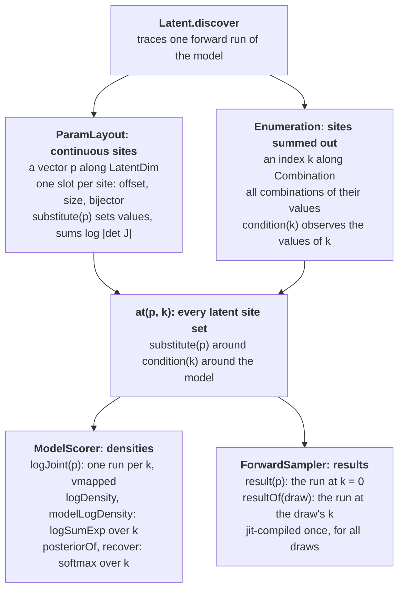

# witdraw: Core Design

How witdraw works internally: the ideas behind its core, how the pieces fit
together, and the decisions that shape them. For using witdraw, see the
[quickstart](quickstart.md).

## Overview

witdraw is a probabilistic programming library for Scala 3 on top of dimwit,
whose labelled tensors run on JAX. A model is ordinary Scala code that samples
named sites; everything else (forward sampling, conditioning, scoring,
inference) is a different way of running that same code.

The mental model in one paragraph: every `Site ~ distribution` in a model is a
call to a `ProbContext`. Handlers wrap the context to change or record those
calls, and an interpreter at the outside decides what each call returns.
`Latent` is the interpreter for inference: it traces the model once, lays the
latent sites out in a parameter vector (and the sites summed out in an
enumeration), and turns the model into a log-density over that space.
Inference algorithms only ever see that log-density and its parameters.

Design goals:

- **The model is the single source of truth.** Prior samples, posterior
  samples and the log-density all come from running the same model, so they
  cannot disagree. Posterior samples have the type of the model's own result.
- **Shapes and dtypes are checked at compile time** through dimwit's labelled
  axes, at sites as everywhere else.
- **Inference is gradient-based and compiled.** Continuous latent sites are
  mapped to unconstrained space; the model is traced and jit-compiled by JAX.
- **Small, composable pieces.** Each handler and interpreter is a few dozen
  lines; features come from composing them, not from special cases.

## Models as programs

A model is a `ProbProg[A] = ProbContext ?=> A`: a context function that, given
a `ProbContext`, runs and returns an `A`. The context has a single method,
`sample(statement): Tensor[T, V]`, and every `Site ~ dist` becomes one call to
it. The model never decides what a site's value is; the context does.

Two kinds of contexts exist:

| Kind | Role | Examples |
| --- | --- | --- |
| Interpreter | The outermost context. Decides each value and what a run produces. | `ForwardSampler` (draws free sites, returns the result), `ModelScorer` (requires every site observed, returns the log-density) |
| Handler | Wraps the context it is given. Sees each statement of its block, may change or record it, then passes it outward. | `observe` (sets `value`), `marginalize` (sets `marginalized`), `withTrace` (records), `ParamLayout.substitute` (sets latent values from parameters) |

In `ForwardSampler.run(key)(withTrace(observe(Y := y)(model)))` a sample call
travels from the model to `observe`, then `withTrace`, then `ForwardSampler`.
Information flows outward only: an inner handler cannot see what an outer one
decides. This is why decisions that depend on every condition on a site, such
as summing it out, belong to the interpreter.

`observe` and `marginalize` share one implementation, `intercept`, which
changes the statements of the named sites and checks that each is given once
and sampled exactly once. A model that samples a site twice is an error
everywhere, because observing or tracing it would be ambiguous.

## Sites, statements and supports

A site is a named random variable, declared as an object with the tensor type
of its values: `object Beta extends Site[Tensor1[Feature, Float32]]`.
`Site[Tensor[T, V]]` is the match type `SiteDef[T, V]`, so shape and dtype are
part of the site's type. Sites are compared by identity; the name is for
display and comes from the object and its enclosing components.

`Beta ~ dist` builds a `SampleStatement` and passes it to the context. The
statement carries everything a handler or interpreter needs:

| Field | Meaning |
| --- | --- |
| `site` | Which site is sampled |
| `distribution` | Its distribution, for drawing and for `logProb` |
| `support` | The values the distribution can take |
| `value` | The site's value, if a handler fixed it: data from `observe`, or a value inference sets, e.g. through `substitute`. Interpreters use it instead of drawing, and score it. |
| `marginalized` | Set by `marginalize`: inference should sum this site out |

The support is found at compile time: `~` takes a `SupportOf[D, T, V]` for the
static type `D` of the distribution, e.g. `HalfNormal` gives
`GreaterThan(loc)`. When no instance is found the default is
`Support.Unknown`, which only fails if the site turns out to be latent.
Supports form an enum: the continuous ones (`Real`, `GreaterThan`, `Interval`,
`Simplex`, `Ordered`, `CorrelationMatrix`, `Rowwise`, `Custom`) and the
discrete ones (`Integers`, `Booleans`, `Discrete`, `Unknown`).

Each continuous support maps to a `Bijector[Z, X]` from unconstrained values to
the support: `forward`, `inverse` and `logDetJac`. For example,
`GreaterThan(0)` uses `exp`, with log-Jacobian `sum(z)`. Bijectors may change
the shape: a simplex along K is built from K - 1 coordinates. `Custom` brings
its own bijector, for supports witdraw does not know. Of the discrete supports,
`Integers` and `Booleans` list their values, so a scalar site with them can be
summed out.

## Traces

`withTrace(model)` is a handler that records every statement after the
handlers further in have changed it, together with the value the outer context
returned. It returns the model's result and a `Trace`: one `TraceEntry` per
site, in sampling order, holding the site, distribution, value, support and the
`fixed` and `marginalized` flags. Which sites are latent depends on the
handlers inside the trace: around `substitute(p)(model)` no site is.

Traces are how witdraw learns the structure of a model without any static
analysis: run it once, look at what happened. Put `withTrace` outside
`observe` and `marginalize`, so it sees their marks. A `Trace` is also a
`SiteValues`, so `trace(Sigma)` reads a site's value with its static type.

## Latent: the inference interpreter

`Latent` turns a conditioned model into something inference can move in. It
interprets the model on two latent spaces, one per kind of latent site, and
both work the same way: built once from a trace, they condition the model on a
point of their space through an ordinary handler.

| | Continuous sites | Sites summed out |
| --- | --- | --- |
| Space | `ParamLayout`: a vector `p` along `LatentDim` | `Enumeration`: an index `k` along `Combination` |
| Built by | `ParamLayout.of(entries)` | `Enumeration.of(entries, otherRun)` |
| Conditions the model with | `layout.substitute(p)`, which also returns the log-Jacobian | `enumeration.condition(k)`, i.e. `observe` of the values in combination `k` |
| A model without such sites | an empty vector | the trivial enumeration: one combination of no sites |

A point `(p, k)` determines every latent site. The private `at(p, k)` composes
both handlers around the model, and every other operation of `Latent` is built
on it.

Discovery builds both spaces; `at(p, k)` composes their handlers around the
model; `ModelScorer` and `ForwardSampler` run it to give densities and results.

`Latent.discover(model)` builds both spaces from one forward run:

1. Trace the model with a fixed key. Unobserved sites are latent.
2. Reject sites that are both observed and marginalized, and latent sites that
   are not `Float32` (they must be observed or summed out).
3. Build the `Enumeration` of the marginalized sites. A second run with another
   key checks that their values do not depend on other sites; it only happens
   when something is summed out. The values come from the support (`Integers`,
   `Booleans`), and the product of their counts is capped at 1,000,000
   combinations.
4. Build the `ParamLayout`: per latent site a `Slot` with its offset and size
   in the vector, its traced value, and the flatten and unflatten functions of
   its bijector's unconstrained value.

The bijector is looked up anew in every run, from the support of that run's
statement. A support may therefore depend on other sites, e.g.
`X ~ Uniform(0, sigma)`. The layout only fixes sizes and offsets, which must
not depend on values.

`Params` is an opaque `Tensor1[LatentDim, Float32]`, path-dependent on its
latent. Inference moves in it; users read results instead. `Result` is the
model's own return type, carried as a type member so that `latent.result(p)`
and `chain.samples` are typed like a forward run.

## Scoring and reading results

Every quantity `Latent` offers is one interpreter run over `at(p, k)`, or a
reduction over `k` of such runs:

| Operation | How it is computed |
| --- | --- |
| `logJoint(p)` (private) | `ModelScorer.runWithResult(at(p, k))`, vmapped over all `k`: per combination, the model's log-density and the same plus the log-Jacobian |
| `modelLogDensity(p)` | `logSumExp` over `k` of the model's log-density. Its maximum is the posterior mode, independent of the bijectors (MAP uses it). |
| `logDensity(p)` | `logSumExp` over `k` of log-density plus log-Jacobian: the density of the unconstrained values (NUTS and Laplace use it) |
| `result(p)` | `ForwardSampler.run(at(p, 0))`, jit-compiled. Only defined when the enumeration is trivial, since otherwise `p` does not fix the model's result. |
| `resultOf(draw)` | The same compiled function at the draw's `(p, k)` |
| `values(p)` (tests only) | The trace of `substitute(p)(model)` |

For a model without sites summed out there is a single combination,
`logSumExp` of one entry is that entry, and the formulas reduce to the familiar
`log p(x, θ) + log |det J|`. `logSumExp` shifts by its maximum unless that is
infinite, so a density of `-inf` stays `-inf` instead of becoming NaN.

Starting values: `init` packs the traced values; `initWith(Sigma := …)` traces
the model at the given values to get the supports there, then packs, and
rejects values outside their support; `initRandom` draws every unconstrained
coordinate uniformly in `[-radius, radius]`, as Stan does.

## Marginalization: mark and interpret

Gradient-based inference cannot move in discrete sites, so witdraw sums them
out: `marginalize(SwitchPoint)(model)` marks the site, and `Latent` samples the
continuous sites θ from the marginal posterior `p(θ | x) ∝ Σ_z p(θ, z, x)`. The
model itself is unchanged: a forward run still draws the marked site.

The split is deliberate. `marginalize` only sets a flag on the statement; the
interpreter does the summing. A transforming handler that summed `z` out itself
could not be conditioned on `z` afterwards: an `observe(Z := z)` around it is
invisible to it, because handlers only see inward. Only the outermost
interpreter knows every condition on a site, so it is the one that decides what
to sum.

So an observation outside the `marginalize` block wins: in
`observe(Z := z)(marginalize(Z)(model))`, `Z` is observed and not summed out,
e.g. a component that sums out its own site, used with that site fixed. An
observation inside the block contradicts the mark, and `marginalize` rejects
it.

The discrete sites come back in two ways, both from the exact conditional
`p(z | θ, x)`, which is the softmax over `k` of `logJoint(p)`:

- `posteriorOf(site)(p)` projects that softmax onto one site's values along
  `Choice`. Averaged over a chain, `posteriorOf(site, chains)` estimates
  `p(z | x)` with less noise than counting draws (Rao-Blackwellisation).
- `recover(chains, key)` draws a combination for every draw at once with the
  Gumbel-max trick and returns chains of `Draw`, a point `(p, k)`. Since
  `p(θ, z | x) = p(θ | x) p(z | θ, x)`, recovered draws are draws from the
  joint posterior, and `chain.samples` reads them as model results.

Both batch all draws into one compiled `vmap`. The draws are stacked on the
host with NumPy first, because JAX's `stack` of thousands of small arrays is
slow.

Limits: a site summed out must be scalar, latent, with finitely many values
that do not depend on other sites (`DiscreteUniform` with fixed bounds,
`Categorical`, `Bernoulli`). Several sites are enumerated jointly as a
Cartesian product, so the cost of each density evaluation grows with the
product of their sizes.

## Inference

Inference algorithms know nothing about models. They see a `Latent` only
through `Params`, `logDensity`, `modelLogDensity`, the `init` methods and a
cache, or they take any log-density over any `TensorTree` position.

| Algorithm | Uses | Mechanism |
| --- | --- | --- |
| `NUTS` | `logDensity` | BlackJAX NUTS; `NUTS.adapt` runs Stan's window adaptation of step size and inverse mass matrix (diagonal or dense) |
| `MAP` | `modelLogDensity` | Adam ascent in unconstrained space, so the mode stays inside the supports and does not depend on the bijectors |
| `Laplace` | `logDensity` | The mode, then a Gaussian with the inverse of the negative Hessian as covariance, in unconstrained space |

All share `SamplingAlgorithm`: an `init` from a position to a state and a
`step` from a key and state to the next state and an info. `sample` runs
`numDraws` steps in one compiled `scan`, so `step` must be traceable; `iterate`
steps one at a time. The compiled kernel is kept with the latent, under a
typed `CacheKey`, so further chains of the same latent reuse it; it lives as
long as the latent, whose log-density it refers to.

A `Chain[P, I]` holds `(position, info)` pairs. `chain.samples` maps each
position to the model's result through a `ModelResult[P, A]` given: for
`latent.Params` it is `latent.result`, for a recovered `Draw` it is
`latent.resultOf`. Several chains are a `Seq[Chain]`; running each in a
`Future` makes them run in parallel on the CPU. `Diagnostics` gives R-hat and
ESS per site.

## Components and site naming

A `Component` is a reusable part of a model that owns its sites, written as a
Scala module: a trait declares the part, and each object extending it is one
instance with its own sites. `object mean extends Linear` inside
`object bloodPressure extends Outcome` gives the site
`bloodPressure.mean.Intercept`.

The mechanism is a given `Scope`. Every `SiteDef` and `Component` takes the
enclosing scope as a `using` parameter; a component provides itself as the
scope for its body, and `Scope.root` is the default outside all components.
Since sites are compared by identity, two instances of the same component never
share a site, and the path only matters for display and errors.

A component can return a typed record of its values (e.g. a
`case class Values`) alongside its output. Such records are tensor trees, so
they appear in the model's result and therefore in every prior and posterior
sample.

## Design decisions and constraints

| Decision | Why | Consequence |
| --- | --- | --- |
| Models are traced, never run eagerly by inference | NUTS, MAP and Laplace all trace the log-density (jit, grad, scan) | A model may not read a latent-dependent value with `.item`; branches on latent values use `where`. dimwit reports the error directly. Control flow on data is fine. |
| Structure is learned from one forward run | No static analysis of Scala code | Which sites are latent, their shapes and the sizes in the layout must not depend on drawn values |
| Bijectors are built per run, from the statement's support | Supports may depend on other sites | The layout fixes only offsets and sizes |
| `marginalize` marks, `Latent` interprets | Marginalized sites stay conditionable by outer handlers | The summing is in the interpreter, not in a model transformation |
| A model without sites summed out is the one-combination case | One code path for scoring and results | Plain models are scored through a `vmap` over an axis of size 1; no measurable slowdown in the test suite |
| Posterior samples are model results | Prior and posterior read the same way, typed | `result` needs the model to return a `TensorTree` |

File map of `core/src/main/scala/witdraw`:

| File | Contents |
| --- | --- |
| `ProbContext.scala` | `ProbProg`, `ProbContext`, `SampleStatement` |
| `Site.scala` | `Site`, `SiteDef`, `~`, `Observation`, `SiteValues`, `ModelResult` |
| `Component.scala` | `Scope`, `Component` |
| `Interpreters.scala` | `ForwardSampler`, `ModelScorer` |
| `Observe.scala` | `observe`, the shared `intercept` |
| `Marginalize.scala` | `marginalize` |
| `Trace.scala` | `TraceEntry`, `Trace`, `withTrace` |
| `Support.scala` | `Support`, `SupportOf`, support to bijector |
| `Bijector.scala` | `Bijector`, `BijectorTo`, the standard bijectors |
| `ParamLayout.scala` | The continuous latent space: slots, `substitute`, starting values |
| `Enumeration.scala` | The discrete latent space: combinations, `condition`, `Choice` |
| `Latent.scala` | The inference interpreter: `discover`, densities, results, `posteriorOf`, `recover` |
| `inference/` | `SamplingAlgorithm`, `Chain`, `NUTS`, `MAP`, `Laplace`, `Diagnostics` |
| `distributions/` | `Half`, `Inverse`, `Ordered`, LKJ and other distributions beyond dimwit's |
